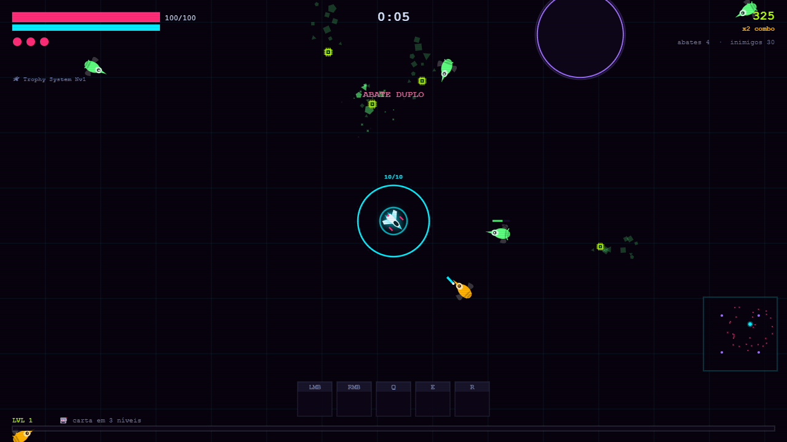
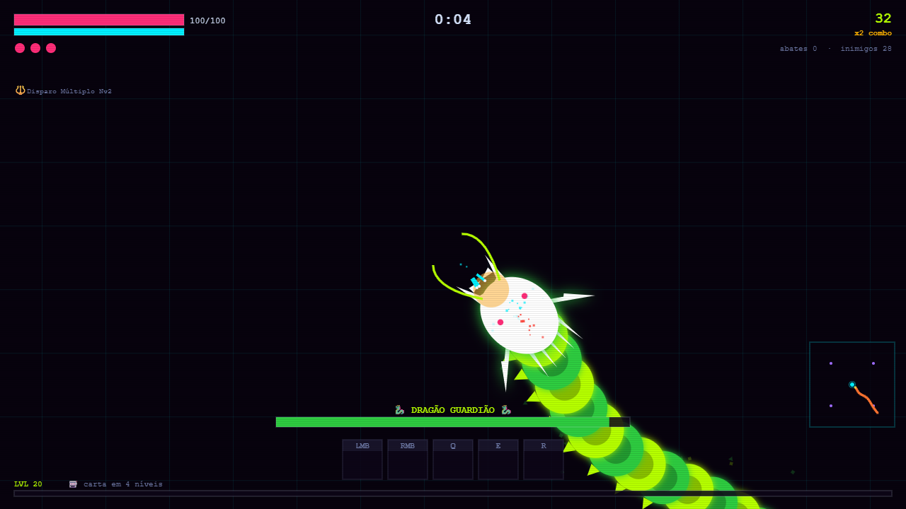

# Geometry Reaper

Jogo de sobrevivência em arena com visual neon cyberpunk: você pilota uma nave geométrica contra hordas que crescem sem parar, sobe de nível, aposta numa máquina de caça-níquel por habilidades novas e enfrenta chefões até o dragão final. Tudo num único arquivo HTML, sem instalar nada, com música gerada pelo próprio navegador.



## Sumário

1. [Por que existe](#por-que-existe)
2. [Como jogar](#como-jogar)
3. [Rodar e publicar](#rodar-e-publicar)
4. [Como mudar um valor](#como-mudar-um-valor)
5. [Como testar](#como-testar)
6. [Estrutura](#estrutura)
7. [Decisões técnicas e limitações](#decisões-técnicas-e-limitações)
8. [Créditos](#créditos)

## Por que existe

É um projeto de game design feito para aprender a equilibrar um sistema com muitas peças: quatro naves com controles diferentes, 15 habilidades, 7 tipos de inimigo, chefões e eventos. A regra que guiou o projeto: **todo número do jogo mora num lugar só** (o bloco `TWEAKS`), para dar para ajustar o jogo sem mexer no motor e medir o efeito de cada ajuste com um robô de testes.

## Como jogar

Abra o `index.html` no navegador, escolha o modo, a nave e uma carta inicial.

### Controles

| Tecla | Fighter e Warrior | Cruiser | Thunderbolt |
|---|---|---|---|
| Mover | WASD | A e D giram o casco, W avança, S dá ré | voa sozinho atrás do mouse; W acelera, S freia |
| Atirar | automático | botão esquerdo (toque = tiro rápido; segure = carga; carga cheia = laser) | segure o botão esquerdo (o canhão esquenta) |
| Habilidades | botão esquerdo, botão direito, Q, E, R | botão direito, Q, E, R, F | botão direito, E, R, F, C |
| Especial | | | A e D: flip com imunidade · Q: Salvo |

**P** ou **Esc** pausa, **M** liga e desliga o som. Nas telas de escolha: **1 a 7** escolhem, **Espaço** puxa a alavanca.

### Modos

| Modo | Objetivo |
|---|---|
| **Survival** | Sobreviver o máximo possível. Cyber Storm, chuva de asteroides, goblin, warden e, a cada 20 níveis seus, um dragão. |
| **Desafio** | Roteiro fixo de 5 minutos que termina num EMP e no Dragão Guardião. Só vence quem mata o dragão. |
| **Challenges** | Três provas: só inimigos corporativos por 5 min, dois wardens juntos, e 5 min sem habilidades (só atributos). |



### Naves

| Nave | Estilo |
|---|---|
| **Fighter** | A mais fácil: mira trava sozinha no inimigo mais próximo. Única com o Drone de Apoio. |
| **Warrior** | Duas torretas de mira livre e um pouco de inércia. |
| **Cruiser** | Cruzador lento com muita vida, leme de navio e torreta independente com railgun que atravessa tudo. |
| **Thunderbolt** | Caça que nunca para, canhão giratório que superaquece, flip com imunidade e o Salvo, que bombardeia o mapa de cima. |

### Progressão

Inimigos soltam chips verdes (XP). A cada nível você ganha um ponto de atributo (ou gira a roleta); a cada 4 níveis, uma carta na máquina de caça-níquel: escolha uma de três ou puxe a alavanca e aposte. O manual dentro do jogo explica cada inimigo, habilidade e evento.

## Rodar e publicar

**No computador:** dê dois cliques no `index.html`. Funciona offline. O ranking fica salvo no navegador.

**Publicar de graça no GitHub Pages:**

1. Suba a pasta para um repositório no GitHub (o `index.html` na raiz).
2. No repositório: **Settings > Pages > Build and deployment > Deploy from a branch**, escolha `main` e a pasta `/ (root)`.
3. Em 1 a 2 minutos o jogo fica em `https://SEU-USUARIO.github.io/NOME-DO-REPOSITORIO/`.

## Como mudar um valor

Todo número de balanceamento está no bloco **`TWEAKS`**, no começo do `<script>` do `index.html` (procure `const TWEAKS`). Cada valor tem um comentário dizendo o que faz e a unidade. A lista completa, com o caminho de cada um, está em **[docs/parametros.md](docs/parametros.md)** (668 parâmetros).

**Passo a passo:**

1. Abra o `index.html` num editor de texto (Bloco de Notas serve; VS Code é melhor).
2. Procure o caminho. Exemplo: `ships.cruiser.rail.damage` = dentro de `ships`, depois `cruiser`, depois `rail`, o campo `damage`.
3. Troque **só o número**. Não apague vírgulas nem renomeie a chave.
4. Salve e recarregue a página. Depois, rode `python ferramentas/testa_jogo.py` para garantir que nada quebrou e `python ferramentas/gera_parametros.py` para atualizar a tabela.

**Os ajustes mais comuns:**

| Quero... | Caminho no `TWEAKS` | Hoje |
|---|---|---|
| mais vida para o jogador | `player.baseHp` | 100 |
| mais vidas por run | `player.lives` | 3 |
| escudo mais forte | `player.baseShield` | 50 |
| blaster do Fighter mais forte | `blaster.damage` | 14 |
| railgun do Cruiser mais forte | `ships.cruiser.rail.damage` | 68 |
| canhão do Thunderbolt mais forte | `ships.thunderbolt.gatling.damage` | 1.2 |
| inimigos nascendo mais rápido | `difficulty.spawnIntervalStart` (segundos entre levas no início) e `difficulty.spawnIntervalMin` (o mais rápido possível) | 0.85 e 0.14 |
| mais inimigos na tela | `difficulty.capMax` | 320 |
| inimigos que ficam fortes mais devagar | `difficulty.hpScalePerMin` | 0.22 |
| dragão com menos vida | `dragon.hp` | 30000 |
| warden com menos vida | `mobs.warden.hp` | 1260 |
| alavanca mais generosa | `slot.chances` (as chances somam 100: `evolve`, `newpow`, `maxpow`, `newmax`, `nothing`...) | 57, 19, 9, 5, 6... |
| roleta com menos azar | `roulette.chances.none` (e redistribua o resto até somar 100) | 23.5 |
| carta com mais frequência | `progression.cardEveryNLevels` | 4 |
| atributo de cadência mais forte | `stats.rofPct` (fração por ponto: 0.42 = +42%) | 0.42 |
| Desafio mais curto | `desafio.endSec` (e os horários dos eventos em `desafio.*`) | 300 |
| música mais baixa | `audio.music` (0 a 1) | 0.32 |

Antes de mudar o equilíbrio entre naves, veja **[docs/proposta-balanceamento.md](docs/proposta-balanceamento.md)**: ela traz os números medidos e as mudanças que ainda estão em aberto.

## Como testar

Precisa de Python 3.8+, do Edge ou do Chrome e de um pacote: `pip install websocket-client`.

```bash
python ferramentas/testa_jogo.py            # abre o jogo, joga uns segundos, confere 14 pontos e refaz as fotos de docs/
python ferramentas/simula_balanceamento.py  # robô joga acelerado e mede o tempo para matar de cada nave (~4 min)
python ferramentas/gera_parametros.py       # refaz docs/parametros.md a partir do TWEAKS (só Python)
```

O teste devolve código 0 quando está tudo certo. Se o navegador não for achado sozinho, defina a variável `NAVEGADOR` com o caminho do executável.

## Estrutura

```
index.html                     o jogo inteiro (HTML, CSS, JavaScript e o bloco TWEAKS)
CHANGELOG.md                   o que mudou em cada versão, com valor antigo e novo
docs/
  parametros.md                todos os parâmetros do TWEAKS (gerado)
  proposta-balanceamento.md    análise com números e mudanças em aberto
  *.png                        capturas usadas neste README (geradas pelo teste)
ferramentas/
  gera_parametros.py           lê o TWEAKS e escreve docs/parametros.md
  testa_jogo.py                teste de fumaça + checagem dos bugs corrigidos + fotos
  simula_balanceamento.py      mede o balanceamento com o robô
  simulador.js                 o robô que roda dentro da página
  navegador.py                 abre o Edge ou o Chrome sem janela (protocolo de depuração)
```

## Decisões técnicas e limitações

- **Um arquivo, zero dependência.** Canvas 2D para o desenho e WebAudio para som e música. Abre offline e publica em qualquer hospedagem estática.
- **TWEAKS como fonte única.** O motor lê tudo de lá; textos de cartas e do manual são montados a partir dos mesmos números, para não mentirem quando o valor muda.
- **Robô de balanceamento.** As simulações chamam as funções do próprio motor com o relógio acelerado. O robô mira perfeito e não morre, então os tempos medidos são o melhor caso.
- **Limitações:** feito para teclado e mouse (não há controle por toque); o ranking é local, por navegador; a música é gerada em tempo real e pode falhar em navegadores que bloqueiam áudio até o primeiro clique (o jogo liga o som ao começar a run).

## Créditos

Criado por Fernando Paoli. Código, desenhos e efeitos sonoros originais.

A **música é procedural e original**: o navegador sintetiza baixo, bateria, metais e trompete em tempo real, numa forma de 16 compassos com trilhas próprias para tempestade, chefão e dragão. O clima é inspirado no estilo das trilhas de fliperama dos anos 90, como a do *3D Pinball: Space Cadet*, sem copiar nenhuma melodia.
